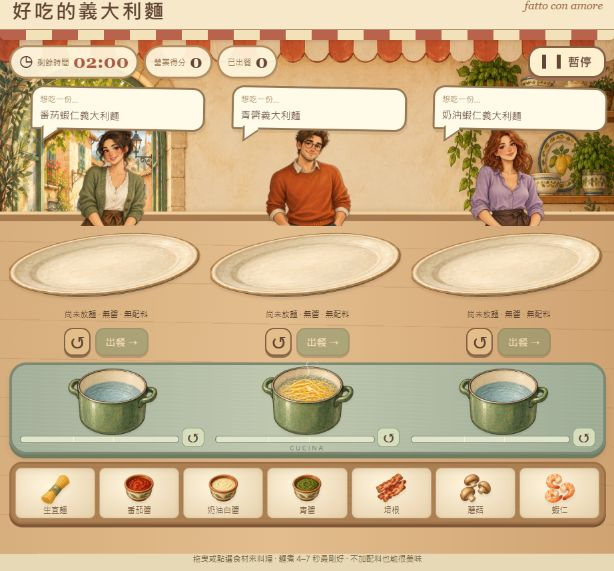

# 好吃的義大利麵

溫暖手繪風單人餐廳小遊戲。120 秒內使用三口獨立煮麵鍋，完成三位客人的訂單。

[線上遊玩](https://hadun5132.github.io/good-pasta-delicious-pasta/)

完整設計與驗收內容見 [規格書](SPEC.md)。

## 開始遊玩

直接以現代瀏覽器開啟 `index.html`，不需安裝套件。可使用滑鼠或手指拖曳，也可點選食材後點目的地；鍵盤可用 Tab、Enter 選擇食材與目的地。

生麵拖入鍋子，再將鍋中麵拖到客人餐盤，加入醬料與配料後出餐。每張訂單有 40% 機率不需要配料。食材不限量，清空不扣分；每個餐盤限一份麵、一種醬及一種配料。暫停或切換分頁會凍結所有計時。

料理台固定在單一視窗內：上方三組客人與餐盤，中間三個鍋子，下方七種食材，不需要捲動頁面。版面依視窗寬高調整；短橫向畫面會將訂單與餐盤並排，縮減說明文字。

## 計分

每份最高 100 分：熟度 40、醬料 40、配料 20。未滿 2 秒熟度 10 分；2～未滿 4 秒 25 分；4～7 秒 40 分；超過 7～10 秒 25 分；超過 10 秒 10 分。醬料與配料分別比對訂單給分，不加配料的訂單若保持不加也得 20 分。只要餐盤有麵就能出餐，缺少或錯誤食材不阻止出餐。

## GitHub Pages 部署

1. 在自己的 GitHub 建立公開儲存庫。
2. 將 `index.html` 上傳到儲存庫根目錄並提交。
3. Settings → Pages → Deploy from a branch，選 main 與 / (root)，儲存。
4. 等待部署完成，使用 Pages 顯示的網址實際遊玩並截圖。

## 程式結構

全部 CSS、JavaScript、SVG 圖像與 AI 生成的原創餐廳背景（Base64）內嵌於 `index.html`，無外部資源與後端。`game` 保存三鍋、訂單與餐盤狀態；`sync` 管理可暫停時間軸；`scoreDish` 分項評分；Pointer Events 處理拖曳。最高分使用 localStorage，存取失敗仍可遊玩。美術方向參考《Good Pizza, Great Pizza》的溫暖餐廳、角色對話與實體料理台配置，人物、食材與背景皆為本作品重新繪製，未使用該遊戲素材。

內嵌圖片採 WebP 壓縮並保留透明背景，單檔約 875 KB，相較原版約 8.8 MB 減少約 90%，不需額外圖片檔案。

## 作業規格說明

主題：好吃的義大利麵。玩家在 120 秒內，使用三口鍋同時煮麵，為三張訂單組裝料理。訂單有麵加醬料及另加配料兩種類型，任何熟度皆能出餐，依熟度、醬料及配料分項計分。支援電腦和手機操作、暫停、本機最高分與結算重玩。

實際討論調整：從一次處理一單修改成三鍋並行、三張訂單各有餐盤；加入無配料訂單；允許未熟起鍋，改用分項計分反映料理品質。名稱統一為「好吃的義大利麵」。

畫面依實際回饋，從像素卡片改為不需捲動的單畫面料理台，再重新設計為手繪餐廳場景、客人對話泡泡、陶盤、琺瑯鍋與木製食材架。計分與料理規則維持一致，網站使用 GitHub Pages 公開。

客人使用 AI 生成的完整半身插畫，不顯示姓名牌。鍋子熟度只顯示進度條，以黃、綠、紅表示熟度變化；白框區段對應 4～7 秒。煮麵時出現冒泡與蒸氣動畫，暫停時停止；偏好減少動態效果的裝置不播放動畫。

鍋具、餐盤、醬料、麵條與配料也使用同一套 AI 生成的水彩手繪素材，與人物、餐廳背景統一質感。所有素材仍內嵌於單一 HTML，無需連線下載圖片。

## 驗證與操作改善

只有醬料或配料時顯示空盤上的實際食材，放入麵條後才顯示義大利麵成品。點選食材會持續標示選取來源及可放置位置，完成操作後清除；提示顯示於上方，避免遮住食材架。

已完成 53 項自動檢查，涵蓋熟度邊界、醬料視覺、加入順序、三鍋獨立狀態、重複出餐防護、清空、暫停、時間到與本機儲存失效。另以瀏覽器實際測試滑鼠拖麵入鍋、撈麵入盤、點選加入食材，以及不符合訂單時的分項計分。

繳交時請附上公開網站網址、實際遊戲截圖與上述規格文字。標題填寫「學校 學號 系級 姓名 好吃的義大利麵」。
